 

##  Player Card

I'm a full-stack developer, entrepreneur, and founder of **[VisionCam, Inc](https://visioncam.net)**. I love building websites, apps, Discord bots, and innovative tech products. My work focuses on software development, creative tools, streaming solutions, AI, and business technology.

- **Current quest:** building **VisionCam**
- **Diving into:** AI
- **I speak:** Polish and English
- **Open to:** collabs, cool projects, and good conversations

##  Inventory

**Languages & Frontend**

**Backend, Data & Tools**

##  Featured Levels

| Level | Description | Tech |
|---|---|---|
| **[VisionCam](https://visioncam.net)** | Streaming and creative tools platform | `TypeScript` `React` `Node.js` |

##  Score Board

 

<code>~~~ KEEP SWIMMING ~~~</code>

